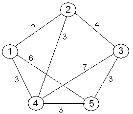

<h1 style="border : none">Considerações</h1>
<h3>Aqui constão algumas pontuações e análises que consideramos importantes na confecção do trabalho.</h3>

O problema das rotas consiste em que achemos o melhor caminho partindo de um ponto 1 à outros passando pelos 24 ginásios e finalmente chegando em um ponto U 

Poderiamos analisar o problema ainda no escopo das matrizes e tentar determinar qual o melhor caminho indo de 1 a U passando pelos 24 ginásios , mas com isso teriamos de trabalhar com todas as casas e a solução para isso não seria exatamente
a mais simples ou mais intuitiva possível.

Por outro lado , é muito interessante retrabalhar o problema da seguinte maneira : Temos de maneira fixada os 24 ginásios , o ponto de partida e o ponto de chegada . Nesse sentido , podemos reduzir o problema para um grafo fortemente conexo
em que cada vértice é capaz de avançar para outro qualquer em uma aresta que custo igual ao menor caminho do lugar X até o lugar Y . (UMA IMAGEM MERAMENTE ILUSTRATIVA PARA UM GRAFO COM 5 NÓDULOS)

Nesse sentido , é muito interessante abordar esse problema de maneira parecida com o problema do caixeiro viajante
que tem um cenário inicial idêntico , em contrapartida , tem um objetivo final diferente . ao invés de tratarmos de um ciclo ao final e de pontos de partidas e chegadas diferentes , temo um ponto de partida e um de entrada fixa e temo que olhar para 
o caminho que pssa por todos os nodulos tal que resolva os valores o custo de maneira ótima.

A ideia é usar uma heurística para abordar a "montagem" dos caminhos de maneira a se aproximar do ótimo de maneira análoga ao problema do caixeiro viajante. Então usaremos o A* nesse grafo reduzido e não no grafo da matriz completa